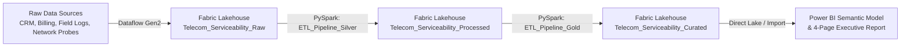

# Telecom_Broadband_Analytics
Microsoft Fabric project for telecom broadband serviceability analytics
# Telecom & Broadband Analytics (Microsoft Fabric & Power BI)

An end-to-end data engineering and business intelligence project. Telemetry and operational logs were ingested into a **Microsoft Fabric Lakehouse** using a medallion architecture (`Bronze` -> `Silver` -> `Gold`), transformed with **PySpark** and **Dataflow Gen2**, modeled into a star schema, and visualized in **Power BI** across four comprehensive operational suites covering serviceability, field operations, customer metrics, and network KPIs.

> **Data note:** All data is synthetic. Multi-source telecommunications telemetry and operational logs were generated programmatically to simulate large-scale broadband serviceability, field force dispatch efficiency, network uptime, and subscriber lifecycle analytics. There are no real customers or transactions, so the findings below describe this dataset and are not results from a real company.

---

## Dashboard preview

| Serviceability Suite | Field Operations Suite |
|---|---|
|  |  |

| Customer Metrics Suite | Network KPI Suite |
|---|---|
|  |  |

---

## Data pipeline



| Step | What was done |
|---|---|
| 1. Raw Ingestion | Ingested raw operational files, customer service logs, and network ticket data via **DF_Telecom_Raw_Ingest** Dataflow into the Bronze layer (`Telecom_Serviceability_Raw.Lakehouse`) |
| 2. Silver Transformation | Executed `ETL_Pipeline_Silver.Notebook` using PySpark to clean, deduplicate, and structure raw feeds into standardized operational tables stored in `Telecom_Serviceability_Processed.Lakehouse` |
| 3. Gold Curation | Executed `ETL_Pipeline_Gold.Notebook` to build business-ready dimensional models, aggregated fact tables, and curated datasets in `Telecom_Serviceability_Curated.Lakehouse` |
| 4. Semantic Modeling | Built `Telecom_Serviceability_Model.SemanticModel` establishing proper relationships and star schema architecture |
| 5. Reporting | Developed `Telecom_Serviceability_Dashboard.Report` featuring a multi-suite navigation pane and executive KPIs |

---

## Business questions

1. What is our overall network uptime, and which regions experience the highest outage frequency?
2. Are our field technicians meeting On-Time Repair and Right-First-Time (RFT) targets?
3. How are customer additions, churn rates, and ARPU trending across product categories (Fiber, HFC, DSL, Fixed Wireless)?
4. Where do we face broadband serviceability gaps and revenue opportunity losses?

---

## Key findings

| Area | Finding |
|---|---|
| Network Uptime | Average network uptime stands at **99.7%**, with 1.4K total outage incidents managed across regional nodes |
| Field Operations | Right First Time Rate (RFTR) is **56.0%** against operational targets, driven by 34K total truck rolls |
| Customer Metrics | Total realized revenue reached **$3,762.6M** with 4,184.2M active subscribers at a **1.4%** churn rate and an ARPU of **$74.9K** |
| Serviceability | Overall serviceability rate is **87.0%**, with high-speed request volume reaching **6.2K** and revenue opportunity loss quantified at **$521.9K** |

---

## Dashboard pages

| Page | What it shows |
|---|---|
| **Serviceability Suite** | High-speed request volume, overbuild rate %, revenue opportunity loss, serviceability demand MoM %, serviceability rate %; footprint & revenue growth by headend location; technology breakdown and regional revenue realization matrix |
| **Field Operations Suite** | Total truck rolls, Right First Time Rate %, operational completion rate %, average job duration (hrs), active operations backlog; MoM trends with moving averages; work order distribution by category; regional efficiency and backlog performance |
| **Customer Metrics Suite** | Total realized revenue, active subscribers, churn rate %, gross new subscribers, ARPU; MRR and active subscriber growth MoM; churn distribution by product category; revenue distribution by product category; regional customer monetization and churn matrix |
| **Network KPI Suite** | Average network uptime, ticket resolution rate %, total outage incidents, active nodes under management, performance aggregation hit rate; outage trends and core node maintenance MoM; maintenance tickets opened MoM by market type; network latency vs. packet loss scatter analysis |

---

## Technical highlights

- **Data architecture:** Multi-layered medallion architecture built on Microsoft Fabric utilizing Bronze, Silver, and Gold Lakehouses (`Telecom_Serviceability_Raw`, `Telecom_Serviceability_Processed`, `Telecom_Serviceability_Curated`).
- **Data Engineering:** Automated ingestion using Dataflow Gen2 (`DF_Telecom_Raw_Ingest`) and complex transformations via PySpark notebooks (`ETL_Pipeline_Silver.Notebook` and `ETL_Pipeline_Gold.Notebook`).
- **Semantic Model & DAX:** Clean star schema with optimized relationships connecting core dimensional entities to fact tables, powering dynamic measures for uptime, churn, and operational KPIs.
- **UI & UX Design:** Custom enterprise blue theme mirroring telecom brand standards, persistent vertical navigation panel for switching between Serviceability, Field Operations, Customer Metrics, and Network KPI suites, and synchronized regional/date filters.

---

## Repository structure

```
.
├── README.md
└── fabric/
    ├── DF_Telecom_Raw_Ingest.Dataflow
    ├── ETL_Pipeline_Gold.Notebook
    ├── ETL_Pipeline_Silver.Notebook
    ├── StagingLakehouseForDataflows_20261009210606.Lakehouse
    ├── StagingWarehouseForDataflows_20261009210606.Warehouse
    ├── Telecom_Serviceability_Curated.Lakehouse
    ├── Telecom_Serviceability_Dashboard.Report
    ├── Telecom_Serviceability_Model.SemanticModel
    ├── Telecom_Serviceability_Processed.Lakehouse
    ├── Telecom_Serviceability_Raw.Lakehouse
    ├── BoardBand Serviceability Suite.PNG
    ├── Boardband Customer Metrics Suite.PNG
    ├── Boardband Field Operation Suite.PNG
    └── Boardband Network KPI Suite.PNG
```

---

## How to run

1. Open your **Microsoft Fabric** workspace and ensure access to the Fabric Lakehouses and Semantic Models.
2. Run `DF_Telecom_Raw_Ingest` Dataflow to populate raw operational tables in `Telecom_Serviceability_Raw.Lakehouse`.
3. Execute `ETL_Pipeline_Silver.Notebook` to clean and process data into `Telecom_Serviceability_Processed.Lakehouse`.
4. Execute `ETL_Pipeline_Gold.Notebook` to finalize curated tables in `Telecom_Serviceability_Curated.Lakehouse`.
5. Open `Telecom_Serviceability_Dashboard.Report` in Power BI / Fabric Service to interact with the executive suites.

---

## Limitations

- The data is synthetic, generated programmatically. Patterns reflect how the dataset was structured rather than real telecom operational anomalies.
- Slicers and filters are tuned per suite to optimize direct lake performance across massive telemetry volumes.

---

## Tools

Microsoft Fabric (Lakehouse, Dataflow Gen2, Notebooks, OneLake) · PySpark · Python · Power BI Desktop · DAX · Power Query (M)

---

## Author

**Md. Reazul Repon**  
[LinkedIn](https://www.linkedin.com/in/repon07) · [GitHub](https://github.com/MReza07)
